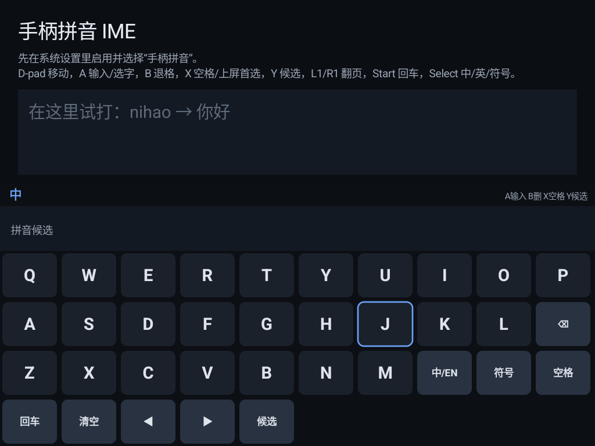

# NGP Pad Pinyin IME（手柄拼音）

A **gamepad-first, offline Pinyin IME** for Android TV / handhelds. Built for the
NGP45HT (GammaOS Core, 1024x768, 2 GB, no touch), but works on Android 11+ with a
D-pad and a text field.

> Status: **MVP v0.1.0** — usable for short Chinese input, English, numbers and
> symbols. No cloud, no network permission.
>
> **Download APK:** [v0.1.0](https://github.com/llj503/ngp-pinyin-ime/releases/tag/v0.1.0)



## 特点

- **10×4 QWERTY 网格**，焦点环完全由 D-pad 移动，不需要触摸屏。
- 离线拼音词库：CC-CEDICT 简体 + jieba 词频，约 **12 万词条 / 8.6 万拼音键**。
- 候选行 8 个/页，支持翻页；首选可直接 X 上屏。
- 英文、数字、符号模式；密码框自动进英文模式。
- 纯 Java + Canvas，无 native 库，APK 约 1.1 MB；2 GB 内存可用。
- 无 INTERNET 权限，不联网、不收集输入。

## 按键

| 键 | 动作 |
| --- | --- |
| D-pad | 移动焦点 / 候选内左右移动 |
| A | 输入字母 / 确认当前键 / 提交候选 |
| B | 退格；拼音缓冲为空时删正文；候选栏内返回 |
| X | 空格；中文有候选时上屏首选 |
| Y | 进入/退出候选栏 |
| L1 / R1 | 候选翻页 |
| Start | 回车 / 执行编辑器动作 |
| Select | 中 → 英 → 符号循环 |

网格焦点在首行按 D-pad 上会进候选栏；候选栏按 D-pad 下回网格。

## 构建

需要 **JDK 17**、**Android SDK platform 34**、**build-tools 34.0.0**。
不需要 Gradle / Android Studio。

```bash
export JDK=/path/to/jdk-17
export SDK=/path/to/Android/Sdk
./build.sh
# 输出 build/ngp-ime.apk
```

构建脚本默认是本机的 `E:/ngp45ht/ime-tools/...`，请按自己的路径覆盖 `JDK` / `SDK`。

词库已打包在 `app/assets/dict.tsv.gz`。要重新生成：

1. 下载 [CC-CEDICT](https://www.mdbg.net/chinese/export/cedict/cedict_1_0_ts_utf-8_mdbg.txt.gz)，
   解压为 `dict/cedict.txt`；
2. 下载 [jieba dict.txt](https://raw.githubusercontent.com/fxsjy/jieba/master/jieba/dict.txt)
   为 `dict/jieba-dict.txt`；
3. 运行 `powershell -File dict/build_dict.ps1`，生成 `dict/dict.tsv` 并压到
   `app/assets/dict.tsv.gz`。

## 安装

```bash
adb install -r build/ngp-ime.apk
adb shell ime enable com.llj.ngpime/.NgpImeService
adb shell ime set com.llj.ngpime/.NgpImeService
```

打开桌面上的 **手柄拼音**（`TestActivity`）即可试打；也可以在任何文本框里切换。

## 开机默认与 GammaOS NGP 镜像

这台 NGP45HT 的 GammaOS 基础镜像里有脚本会在开机时把默认 IME 改成 AOSP
（以及 `rg52-ime.sh` 的强制目标）。要让手柄拼音在重启后保持默认：

1. 设置持久值：
   ```bash
   adb shell su -c 'setprop persist.rg52.ime com.llj.ngpime/.NgpImeService'
   ```
2. 使用尊重 `persist.rg52.ime` 的 `rg52-wifi-fix.sh`（本仓配套镜像
   [GammaOSNext-PokectAis](https://github.com/llj503/GammaOSNext-PokectAis)
   的 `image_build/rg52-wifi-fix.sh` 已含此逻辑），或自行改掉强制写 AOSP 的那几行。

镜像构建会把 APK 放到 `/system/app/NgpIme/NgpIme.apk`，并在无用户选择时优先
使用它；AOSP Leanback 仍保留为回退。

## 已知限制（MVP）

- 按**词**输入，不做长句切分/智能联想；一次打一个词最稳。
- 没有用户词库/学习词频；候选顺序按 CC-CEDICT + jieba 频率。
- 多音字/多音词可能不完美；CC-CEDICT 的拼音为准。
- 没有 T9、手写、语音、皮肤；没有触摸键盘交互。
- 切换模式会清掉当前拼音缓冲。
- 这是 Alpha 级实现，部分应用的自定义输入框可能不调用系统 IME。

## 目录

```
app/                  Android 源码、Manifest、资源、打包的词典
dict/                 词库构建脚本与 CC-CEDICT/jieba 许可证
keystore/debug.keystore  固定 debug 签名（仅用于可重复构建，不要用于生产）
docs/screenshot-keyboard.png
build.sh              aapt2 + javac + d8 + apksigner 构建脚本
```

## 许可

- 本仓库代码：**Apache License 2.0**，见 `LICENSE`。
- `app/assets/dict.tsv.gz` 派生自 **CC-CEDICT**（CC BY-SA 4.0）与 **jieba**
  词频（MIT）；详见 `THIRD_PARTY_NOTICES.md` 和 `dict/` 下的许可证文本。
- Android SDK 不随本仓库分发。
